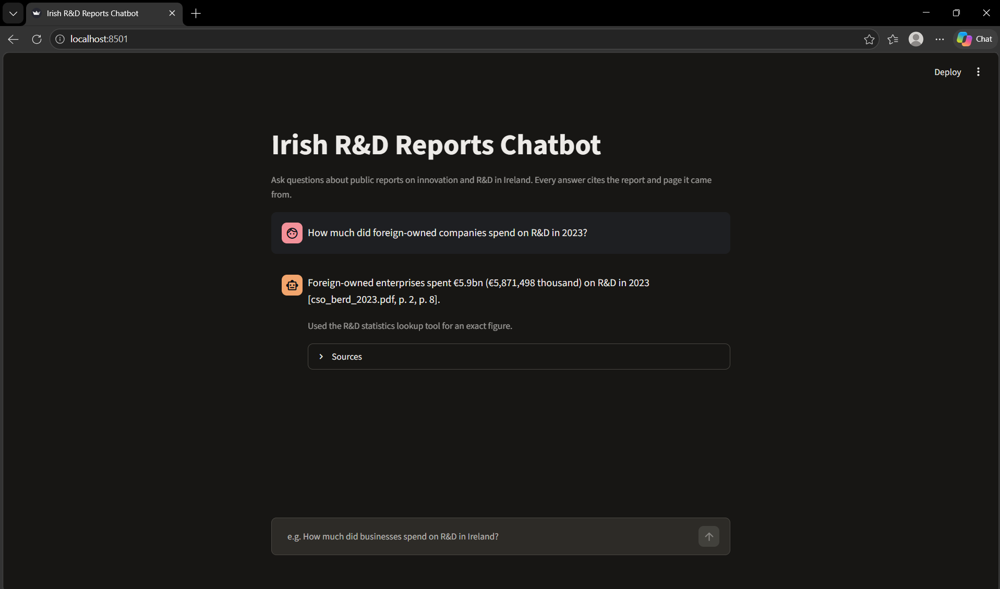

# Irish R&D Reports Chatbot

A chatbot that answers questions about public Irish reports on R&D and innovation, using retrieval-augmented generation (RAG). Each answer cites the report and page it came from. If a question needs an exact figure, the model can call a small lookup tool that reads the number from a statistics table instead of guessing it.

I built it to practise RAG and tool calling on real Irish public data. It uses Python, the Google Gemini API (free tier), NumPy, pandas and Streamlit, with no LangChain, so the whole pipeline is in about 270 lines of plain code.



## How it works

```
PDF reports ──> split into chunks ──> Gemini embeddings ──> index/
                                                             │
question ──> embed question ──> find 4 closest chunks ───────┘
                                        │
                                        v
                       Gemini reads the chunks and the question
                                        │
                      needs an exact figure? ──yes──> lookup_rd_stats tool (CSV)
                                        │                       │
                                        v                       v
                          answer with [report, page] citations
```

1. `ingest.py` reads each PDF page by page, cuts the text into 1,000-character chunks that overlap by 200 characters, embeds each chunk with `gemini-embedding-001` and saves the index.
2. `rag.py` embeds the question, finds the four closest chunks by cosine similarity and sends them to `gemini-3.5-flash-lite`. The prompt tells the model to cite its sources and to say "I don't know" when the reports don't cover the question.
3. The model also gets one tool, `lookup_rd_stats`. It decides on its own when a question needs an exact number, calls the tool with a few keywords, and gets back the matching rows from `data/rd_stats.csv`.
4. `app.py` is a Streamlit chat page. It shows the answer, says whether the lookup tool was used, and lists the source passages.
5. The free Gemini tier is sometimes busy, so the code waits and retries before giving up.

## Data

- CSO, Business Expenditure on Research and Development 2023 (Final) - 2024 (Preliminary)
- CSO, Business in Ireland 2025: Innovation in Irish Enterprises
- `data/rd_stats.csv`: 13 published figures from the CSO and IDA Ireland, used by the lookup tool

The PDFs aren't in this repository. To rebuild the index, save the two CSO pages as PDFs into `data/reports/`.

## Run it yourself

```bash
python -m venv .venv
.venv\Scripts\activate           # Mac: source .venv/bin/activate
pip install -r requirements.txt
copy .env.example .env           # then paste a free key from https://aistudio.google.com/apikey
python ingest.py                 # builds the search index
streamlit run app.py             # opens the chatbot in your browser
pytest                           # runs the unit tests
```

## Example questions

- How much did foreign-owned companies spend on R&D in 2023?
- How many people worked in R&D in Ireland in 2023?
- What share of R&D spending came from large enterprises?

## Limitations

- Scanned PDFs have no text layer, so they can't be read without OCR.
- The lookup tool matches keywords, so it works best with plain terms like a year or a sector.
- Answers only cover what's in the reports in `data/reports/`.